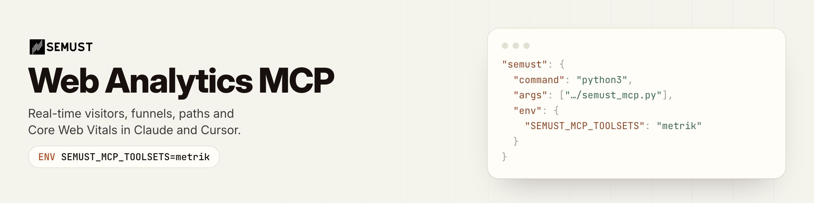
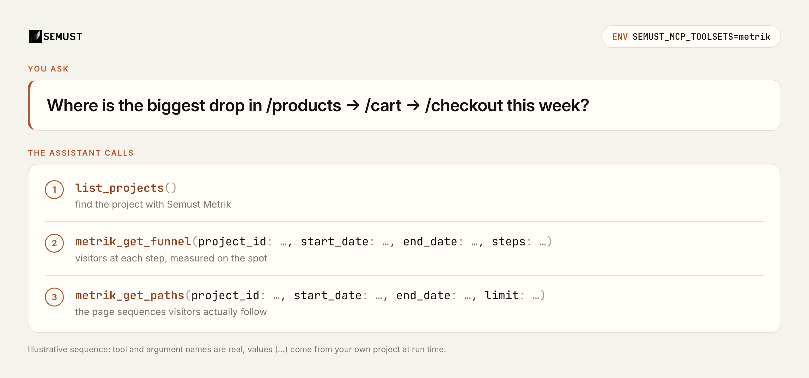
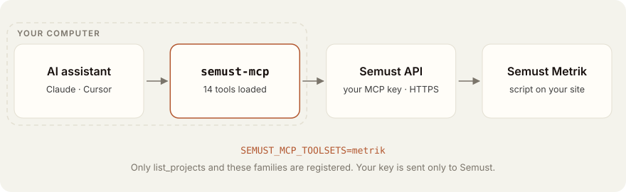

# Web Analytics MCP Server

[](https://semust.com/en/features/mcp/web-analytics-mcp?utm_source=github&utm_medium=referral&utm_campaign=web-analytics-mcp&utm_content=banner)

[](https://app.semust.com/settings?tab=mcp&utm_source=github&utm_medium=referral&utm_campaign=web-analytics-mcp&utm_content=badge)
[](https://semust.com/en/docs/mcp/tools/metrik?utm_source=github&utm_medium=referral&utm_campaign=web-analytics-mcp&utm_content=badge)
[](https://github.com/Semust-com/semust-mcp)
[](LICENSE)

The [Web Analytics MCP server](https://semust.com/en/features/mcp/web-analytics-mcp?utm_source=github&utm_medium=referral&utm_campaign=web-analytics-mcp&utm_content=intro) connects Semust Metrik, Semust's privacy-friendly first-party analytics, to Claude, Claude Code and Cursor. Ask about today's visitors, funnel drop-offs, the page paths visitors follow, goals, e-commerce revenue and Core Web Vitals from real visitors.

There is **no reporting delay**: today's data is available today. Funnels need no setup either; list the steps in the chat and the assistant measures them on the spot. The tools return aggregates only, never individual visitor profiles or sessions. It is part of [Semust](https://semust.com/en?utm_source=github&utm_medium=referral&utm_campaign=web-analytics-mcp&utm_content=intro), the SEO and analytics platform behind the data.

> [!NOTE]
> This repository contains no server code. It is a ready-made setup for the open-source [Semust MCP server](https://github.com/Semust-com/semust-mcp) that loads only the 14 tools you need here, with `SEMUST_MCP_TOOLSETS=metrik`. Copy a config from [`configs/`](configs), add your key and path, and restart your client.

- [What you can ask](#what-you-can-ask)
- [How it works](#how-it-works)
- [Setup](#setup)
- [Tools in this server](#tools-in-this-server)
- [Requirements](#requirements)
- [Security](#security)
- [Troubleshooting](#troubleshooting)
- [FAQ](#faq)
- [Learn more](#learn-more)

## What you can ask

Type these as they are or in your own words. The assistant picks the tool itself.

- How many people are on the site right now, and on which pages?
- Compare today's visitors by channel with yesterday.
- Where is the biggest drop in /products → /cart → /checkout?
- What page sequence do homepage visitors follow most often?
- Did form submissions drop this month compared to last month?
- Which 10 pages have the worst 75th percentile LCP?
- Which channels sold my best-selling products in the last 30 days?
- How many billable events have I used this month?

[`prompts.md`](prompts.md) has 18 copy-paste prompts, grouped by task.



## How it works

<picture>
  <source media="(prefers-color-scheme: dark)" srcset="images/how-it-works-dark.svg">
  
</picture>

Your assistant talks to the Semust MCP server on your computer. With `SEMUST_MCP_TOOLSETS=metrik` the server registers 14 tools: `list_projects` and the thirteen Semust Metrik tools. Each call goes to the Semust API with your MCP key, and Semust answers from the data its tracking script collects on your site, in real time.

## Setup

Setup takes about five minutes: create a key, download the server once, then paste one config.

### 1. Create an MCP key

Log in to Semust and open [Settings → MCP Setup](https://app.semust.com/settings?tab=mcp&utm_source=github&utm_medium=referral&utm_campaign=web-analytics-mcp&utm_content=setup). Create an **MCP key**: it starts with `smk_` and is shown only once, so copy it straight away. A key can reach all your projects or just one, expires after 30, 90 or 365 days, and can be renewed or revoked on the same page.

Leave **"Can post to social media"** switched off. The tools in this server only read data, and a read-only key is all they need.

### 2. Install the Semust MCP server

This repository holds the setup, not the server. Download the open-source [Semust MCP server](https://github.com/Semust-com/semust-mcp) once and install its three dependencies:

```bash
git clone https://github.com/Semust-com/semust-mcp.git
cd semust-mcp
pip install -r requirements.txt   # use pip3 if pip is not found
pwd                               # prints the folder; the config below needs its absolute path
```

Prefer a virtual environment? Run `python3 -m venv .venv && .venv/bin/pip install -r requirements.txt` instead, and use `/absolute/path/to/semust-mcp/.venv/bin/python` as the `command` in the configs below. Your server then keeps working whatever happens to your system Python.

> [!IMPORTANT]
> `SEMUST_MCP_TOOLSETS` needs semust-mcp **1.9.0 or newer**. An older copy ignores it and loads every tool, so run `git pull` in the `semust-mcp` folder if you installed it before.

### 3. Add it to your AI client

| Client | Ready-made file |
| --- | --- |
| Claude Desktop | [`configs/claude_desktop_config.json`](configs/claude_desktop_config.json) |
| Claude Code | [`configs/claude-code.sh`](configs/claude-code.sh) |
| Cursor | [`configs/cursor-mcp.json`](configs/cursor-mcp.json) |

In each, replace `your-api-key-here` with your MCP key and `/absolute/path/to/semust-mcp/semust_mcp.py` with the real path from step 2.

#### Claude Desktop

Add this to `claude_desktop_config.json` ([full guide](https://semust.com/en/docs/mcp/setup/claude-desktop?utm_source=github&utm_medium=referral&utm_campaign=web-analytics-mcp&utm_content=setup)):

```json
{
  "mcpServers": {
    "semust": {
      "command": "python3",
      "args": [
        "/absolute/path/to/semust-mcp/semust_mcp.py"
      ],
      "env": {
        "SEMUST_API_KEY": "your-api-key-here",
        "SEMUST_MCP_TOOLSETS": "metrik"
      }
    }
  }
}
```

<details>
<summary><b>Where is <code>claude_desktop_config.json</code>?</b></summary>

| System | Folder |
| --- | --- |
| macOS | `~/Library/Application Support/Claude/` (Finder → <kbd>Cmd</kbd>+<kbd>Shift</kbd>+<kbd>G</kbd>) |
| Windows | `%APPDATA%\Claude\` |
| Windows (Microsoft Store) | `%LOCALAPPDATA%\Packages\Claude_pzs8sxrjxfjjc\LocalCache\Roaming\Claude\` |

If the file is not there yet, create it. If it already has other servers, add the `"semust"` entry inside the existing `"mcpServers"` object instead of pasting a second one.
</details>

<details>
<summary><b>Windows, or <code>python3</code> not found?</b></summary>

- The path in `args` must be **absolute**. Claude Desktop does not expand `~`.
- On Windows use `"command": "python"` and a path with double backslashes, such as `"C:\\Users\\you\\semust-mcp\\semust_mcp.py"`. If `python` is not recognised, give the full path to `python.exe`.
- On macOS and Linux there is often no `python`, only `python3`. Run `which python3` and use the full path it prints if the server does not start.
</details>

You do not need `SEMUST_BASE_URL`: the server already points at the Semust API.

**Restart the client completely** after editing the file. On macOS press <kbd>Cmd</kbd>+<kbd>Q</kbd>; on Windows quit from the system tray icon. Closing the window is not enough.

#### Claude Code

Claude Code registers servers from the command line, so there is no file to edit:

```bash
claude mcp add --scope user semust \
  -e SEMUST_API_KEY=your-api-key-here \
  -e SEMUST_MCP_TOOLSETS=metrik \
  -- python3 /absolute/path/to/semust-mcp/semust_mcp.py
```

`--scope user` makes the server available in every project. To keep the key out of your shell history, put `SEMUST_API_KEY` and `SEMUST_MCP_TOOLSETS` in a `.env` file next to `semust_mcp.py` instead and leave out the `-e` flags; the server reads that file on startup.

#### Cursor

Copy the contents of [`configs/cursor-mcp.json`](configs/cursor-mcp.json) into `~/.cursor/mcp.json` to use the server in every project, or into `.cursor/mcp.json` inside one project. You can also add it from Cursor's settings as a stdio server with the same command, path and environment ([Cursor guide](https://semust.com/en/docs/mcp/setup/cursor?utm_source=github&utm_medium=referral&utm_campaign=web-analytics-mcp&utm_content=setup)).

#### Other MCP clients

Any client that runs stdio MCP servers works: command `python3` (or `python` on Windows), argument the absolute path to `semust_mcp.py`, and the environment variables `SEMUST_API_KEY` and `SEMUST_MCP_TOOLSETS=metrik`. See [other MCP clients](https://semust.com/en/docs/mcp/setup/other-clients?utm_source=github&utm_medium=referral&utm_campaign=web-analytics-mcp&utm_content=setup).

### 4. Check that it works

Open a new chat and ask **"Show me my Semust projects"**. The assistant calls `list_projects` and lists your projects with the integrations each one has connected. Claude Desktop shows the `semust` server with 14 tools in its tools menu; in Claude Code, `claude mcp list` should report `semust` as connected and `/mcp` lists the tools.

### Adding more Semust tools later

`SEMUST_MCP_TOOLSETS` takes a comma-separated list, so one server can cover several sources: for example `"gsc,ga,gads"` for Search Console, Analytics and Ads together. `list_projects` is always included. Unset, empty or `all` loads all 82 tools, and a misspelt family name also loads everything (with a warning), so a typo never hides tools.

| Family | Tools | Family | Tools |
| --- | --- | --- | --- |
| `gsc` | Google Search Console data and reports | `ym` | Yandex Metrica |
| `ga` | Google Analytics 4 | `bing` | Bing Webmaster |
| `gads` | Google Ads | `metrik` | Semust Metrik web analytics |
| `rank` | Rank Tracker | `changes` | Change Monitor |
| `aiRank` | AI Overview Tracker | `competitor` | Competitor Analysis |
| `indexing` | Index Monitor | `social` | LinkedIn, Facebook and Instagram posting |

## Tools in this server

With `SEMUST_MCP_TOOLSETS=metrik` the server registers these 14 tools. Every parameter is documented in the linked reference pages.

**Always loaded** · [projects reference](https://semust.com/en/docs/mcp/tools/projects?utm_source=github&utm_medium=referral&utm_campaign=web-analytics-mcp&utm_content=tools)

| Tool | What it does |
| --- | --- |
| `list_projects` | Lists your projects and which integrations each one has connected. |

**Semust Metrik** · [Semust Metrik reference](https://semust.com/en/docs/mcp/tools/metrik?utm_source=github&utm_medium=referral&utm_campaign=web-analytics-mcp&utm_content=tools)

| Tool | What it does |
| --- | --- |
| `metrik_get_overview` | First-party analytics summary with period-over-period change. |
| `metrik_get_timeseries` | The daily Semust Metrik series. |
| `metrik_get_breakdown` | Breaks traffic down by pages, sources, geography or technology. |
| `metrik_get_events` | Event counts such as clicks, form submits, outbound links and pageviews. |
| `metrik_compare_events` | Compares events between two periods: what visitors do more, or less, than before. |
| `metrik_get_goals` | Goal completions and conversion rates. |
| `metrik_get_products` | Sales per product from e-commerce tracking. |
| `metrik_get_revenue_breakdown` | Revenue by country or device. |
| `metrik_get_funnel` | Measures a funnel you describe in the conversation; no setup in Semust first. |
| `metrik_get_paths` | The page sequences visitors follow most often. |
| `metrik_get_web_vitals` | Core Web Vitals measured on real visitors (field data, not a lab test). |
| `metrik_get_live` | Who is on the site right now, and whether the tracking script is reporting. |
| `metrik_get_usage` | This month's billable event count. |

## Requirements

- [Python 3.10 or newer](https://www.python.org/downloads/) and semust-mcp **1.9.0 or newer**.
- An MCP client: [Claude Desktop](https://claude.ai/download), [Claude Code](https://claude.com/claude-code), [Cursor](https://cursor.com) or any client that runs stdio servers.
- A [Semust account](https://app.semust.com/register?utm_source=github&utm_medium=referral&utm_campaign=web-analytics-mcp&utm_content=requirements) with an active plan; the trial counts.
- **Semust Metrik** active on the project: create a tracking key under Project Settings → Semust Metrik and add the script it gives you to your site. Data starts with the first visit; no third-party integration is needed.

## Security

Every tool in this server **only reads data**, and only aggregates: counts, rates, breakdowns and paths combined across sessions. Nothing identifies a single visitor. The usage tool reads this month's billable event count; the assistant's own queries are not events.

- **The server runs on your computer.** It is a local process that your AI client starts, not a hosted service.
- **Your key stays on your machine.** It lives in your client config or in a `.env` file next to `semust_mcp.py`, and is only sent to the Semust API. Claude, Cursor and Anthropic never see it; they only see the data returned for your question.
- **HTTPS only.** The server refuses to start if its API address is plain `http://` (other than localhost), so the key is never sent in clear text.
- **Protect your config file.** Anyone who can read `claude_desktop_config.json` or `~/.cursor/mcp.json` can read the key in it. Never commit those files; this repository's `.gitignore` already excludes `.env`.
- **Limit and revoke.** Tie a key to one project, choose a 30, 90 or 365-day expiry, and revoke it in [Settings → MCP Setup](https://app.semust.com/settings?tab=mcp&utm_source=github&utm_medium=referral&utm_campaign=web-analytics-mcp&utm_content=security) at any time.
- **Third-party text is data.** Results can contain text written by others, such as search queries or page titles. An AI model may follow instructions hidden in such text; that is true of every MCP server that surfaces outside data. Read your assistant's suggestions before acting on them.

More detail: [Semust MCP security guide](https://semust.com/en/docs/mcp/guides/security?utm_source=github&utm_medium=referral&utm_campaign=web-analytics-mcp&utm_content=security).

## Troubleshooting

| Problem | Fix |
| --- | --- |
| The server does not appear | Quit the client completely and reopen it. Check that the path in `args` is absolute and that `python3` runs in a terminal. |
| You see all 82 tools, not 14 | Your semust-mcp copy is older than 1.9.0. Run `git pull` in its folder and restart the client. |
| "Invalid API key" (401) | Copy the key again from Settings → MCP Setup; it may have expired or been revoked. |
| "User not active" (403) | The Semust account needs an active plan or trial. |
| "... not connected" | Connect the integration for that project in Semust, then ask again. |
| `No module named 'mcp.server.fastmcp'` | Update semust-mcp (`git pull`) and run `pip install -U -r requirements.txt`. |

More fixes: [Semust MCP troubleshooting](https://semust.com/en/docs/mcp/guides/troubleshooting?utm_source=github&utm_medium=referral&utm_campaign=web-analytics-mcp&utm_content=troubleshooting).

## FAQ

### What is the Web Analytics MCP?

Thirteen tools that open Semust Metrik, Semust's own analytics, to Claude Desktop, Claude Code and Cursor: visitors, sources, events, goals, revenue, funnels, paths and page speed, plus `list_projects`.

### Is it really real time?

Yes, there is no delay. Google Analytics lags about a day and Search Console two. The live visitor count covers the last five minutes.

### Can I see individual visitors?

No. The tools return aggregates only: counts, rates, breakdowns and paths combined across sessions.

### Do I need to set up funnels in Semust first?

No. List page paths or a Semust goal in the chat. Unsure of the paths? Ask for top pages or real visitor paths first.

### The tools return zeros. Is something broken?

Ask the assistant to check live visitors. If the tracking script has never reported, the key exists but the script is not on your site yet, which is not the same as having no traffic.

### Does it cost anything?

The Semust MCP server is free and open source under the MIT license. The data it reads needs an active Semust plan, and the trial counts.

## Learn more

- [Web Analytics MCP product page](https://semust.com/en/features/mcp/web-analytics-mcp?utm_source=github&utm_medium=referral&utm_campaign=web-analytics-mcp&utm_content=learn_more) · [Türkçe sayfa](https://semust.com/ozellikler/mcp/web-analitik-mcp?utm_source=github&utm_medium=referral&utm_campaign=web-analytics-mcp&utm_content=learn_more)
- [Semust MCP: all 82 tools on one page](https://semust.com/en/features/mcp?utm_source=github&utm_medium=referral&utm_campaign=web-analytics-mcp&utm_content=learn_more) · [Türkçe](https://semust.com/ozellikler/mcp?utm_source=github&utm_medium=referral&utm_campaign=web-analytics-mcp&utm_content=learn_more)
- [Semust MCP installation guide](https://semust.com/en/docs/mcp/installation?utm_source=github&utm_medium=referral&utm_campaign=web-analytics-mcp&utm_content=learn_more) · [Kurulum rehberi (Türkçe)](https://semust.com/docs/mcp/installation?utm_source=github&utm_medium=referral&utm_campaign=web-analytics-mcp&utm_content=learn_more)
- [Semust Metrik tool reference](https://semust.com/en/docs/mcp/tools/metrik?utm_source=github&utm_medium=referral&utm_campaign=web-analytics-mcp&utm_content=learn_more) · [Türkçe](https://semust.com/docs/mcp/tools/metrik?utm_source=github&utm_medium=referral&utm_campaign=web-analytics-mcp&utm_content=learn_more)
- [Example workflows](https://semust.com/en/docs/mcp/guides/example-workflows?utm_source=github&utm_medium=referral&utm_campaign=web-analytics-mcp&utm_content=learn_more)
- [Core Web Vitals (Turkish)](https://semust.com/blog/core-web-vitals?utm_source=github&utm_medium=referral&utm_campaign=web-analytics-mcp&utm_content=learn_more)
- [SEO report vs SEO reporting dashboard](https://semust.com/en/blog/seo-report-vs-seo-reporting-dashboard?utm_source=github&utm_medium=referral&utm_campaign=web-analytics-mcp&utm_content=learn_more)
- [What is MCP? The Model Context Protocol explained](https://semust.com/en/blog/what-is-mcp?utm_source=github&utm_medium=referral&utm_campaign=web-analytics-mcp&utm_content=learn_more)
- [The best MCP servers](https://semust.com/en/blog/best-mcp-servers?utm_source=github&utm_medium=referral&utm_campaign=web-analytics-mcp&utm_content=learn_more)

## Related repositories

**SEO data APIs**

| Repository | What it does | Product page |
| --- | --- | --- |
| [google-serp-scraper](https://github.com/Semust-com/google-serp-scraper) | Organic results, People Also Ask, AI Overviews, ads and more as JSON | [Google SERP API](https://semust.com/en/api-platform/serp-api?utm_source=github&utm_medium=referral&utm_campaign=web-analytics-mcp&utm_content=related) |
| [google-images-scraper](https://github.com/Semust-com/google-images-scraper) | Google Images results with titles, source pages and image URLs | [Google Images API](https://semust.com/en/api-platform/google-images-api?utm_source=github&utm_medium=referral&utm_campaign=web-analytics-mcp&utm_content=related) |
| [youtube-scraper](https://github.com/Semust-com/youtube-scraper) | YouTube search, video details, transcripts and comments | [YouTube API](https://semust.com/en/api-platform/youtube-api?utm_source=github&utm_medium=referral&utm_campaign=web-analytics-mcp&utm_content=related) |
| [google-trends-scraper](https://github.com/Semust-com/google-trends-scraper) | Interest over time, regions, related queries and demographics | [Google Trends API](https://semust.com/en/api-platform/trends-api?utm_source=github&utm_medium=referral&utm_campaign=web-analytics-mcp&utm_content=related) |
| [google-business-scraper](https://github.com/Semust-com/google-business-scraper) | Google Business profiles, local search and reviews | [Google Business Data API](https://semust.com/en/api-platform/business-data-api?utm_source=github&utm_medium=referral&utm_campaign=web-analytics-mcp&utm_content=related) |
| [keyword-research-api](https://github.com/Semust-com/keyword-research-api) | Search volume, CPC, competition, intent and related keywords | [Keyword Research API](https://semust.com/en/api-platform/keyword-research-api?utm_source=github&utm_medium=referral&utm_campaign=web-analytics-mcp&utm_content=related) |
| [backlinks-api](https://github.com/Semust-com/backlinks-api) | Backlinks, referring domains, anchors and link history | [Backlinks API](https://semust.com/en/api-platform/backlinks-api?utm_source=github&utm_medium=referral&utm_campaign=web-analytics-mcp&utm_content=related) |
| [domain-research-api](https://github.com/Semust-com/domain-research-api) | Organic keywords, competitors, top pages and keyword gaps for any domain | [Domain Research API](https://semust.com/en/api-platform/domain-research-api?utm_source=github&utm_medium=referral&utm_campaign=web-analytics-mcp&utm_content=related) |
| [technical-seo-api](https://github.com/Semust-com/technical-seo-api) | 27 technical SEO checks for any URL in one call | [Technical SEO API](https://semust.com/en/api-platform/technical-seo-api?utm_source=github&utm_medium=referral&utm_campaign=web-analytics-mcp&utm_content=related) |
| [lighthouse-on-page-api](https://github.com/Semust-com/lighthouse-on-page-api) | Lighthouse scores, on-page audits and page content extraction | [Lighthouse & On-Page API](https://semust.com/en/api-platform/on-page-api?utm_source=github&utm_medium=referral&utm_campaign=web-analytics-mcp&utm_content=related) |

**MCP servers for AI assistants**

| Repository | What it does | Product page |
| --- | --- | --- |
| [semust-mcp](https://github.com/Semust-com/semust-mcp) | One MCP server for Search Console, GA4, Google Ads, rank tracking and social posting | [Semust MCP Server](https://semust.com/en/features/mcp?utm_source=github&utm_medium=referral&utm_campaign=web-analytics-mcp&utm_content=related) |
| [seo-mcp](https://github.com/Semust-com/seo-mcp) | Search Console, rank tracking, indexing and competitor tools for AI assistants | [SEO MCP](https://semust.com/en/features/mcp/seo-mcp?utm_source=github&utm_medium=referral&utm_campaign=web-analytics-mcp&utm_content=related) |
| [google-search-console-mcp](https://github.com/Semust-com/google-search-console-mcp) | Ask your AI assistant about clicks, queries and pages | [Google Search Console MCP](https://semust.com/en/features/mcp/google-search-console-mcp?utm_source=github&utm_medium=referral&utm_campaign=web-analytics-mcp&utm_content=related) |
| [google-analytics-mcp](https://github.com/Semust-com/google-analytics-mcp) | GA4 traffic, channels and conversions in your AI assistant | [Google Analytics MCP](https://semust.com/en/features/mcp/google-analytics-mcp?utm_source=github&utm_medium=referral&utm_campaign=web-analytics-mcp&utm_content=related) |
| [google-ads-mcp](https://github.com/Semust-com/google-ads-mcp) | Campaigns, search terms and spend in your AI assistant | [Google Ads MCP](https://semust.com/en/features/mcp/google-ads-mcp?utm_source=github&utm_medium=referral&utm_campaign=web-analytics-mcp&utm_content=related) |
| [rank-tracker-mcp](https://github.com/Semust-com/rank-tracker-mcp) | Keyword rankings and AI-search visibility for AI assistants | [Rank Tracker MCP](https://semust.com/en/features/mcp/rank-tracker-mcp?utm_source=github&utm_medium=referral&utm_campaign=web-analytics-mcp&utm_content=related) |
| [bing-webmaster-mcp](https://github.com/Semust-com/bing-webmaster-mcp) | Bing queries, pages, links and crawl issues | [Bing Webmaster MCP](https://semust.com/en/features/mcp/bing-webmaster-mcp?utm_source=github&utm_medium=referral&utm_campaign=web-analytics-mcp&utm_content=related) |
| [yandex-metrica-mcp](https://github.com/Semust-com/yandex-metrica-mcp) | Yandex Metrica traffic and search phrases | [Yandex Metrica MCP](https://semust.com/en/features/mcp/yandex-metrica-mcp?utm_source=github&utm_medium=referral&utm_campaign=web-analytics-mcp&utm_content=related) |
| [social-media-mcp](https://github.com/Semust-com/social-media-mcp) | Draft and schedule LinkedIn, Facebook and Instagram posts | [Social Media MCP](https://semust.com/en/features/mcp/social-media-mcp?utm_source=github&utm_medium=referral&utm_campaign=web-analytics-mcp&utm_content=related) |

## Support

- Email: [destek@semust.com](mailto:destek@semust.com)
- [Contact form](https://semust.com/en/contact?utm_source=github&utm_medium=referral&utm_campaign=web-analytics-mcp&utm_content=footer)
- [LinkedIn](https://www.linkedin.com/company/semust) · [YouTube](https://www.youtube.com/channel/UCr1u7f20OWeOPKWRhBQwNew) · [Instagram](https://www.instagram.com/trysemust)

Found a problem with an example? [Open an issue](https://github.com/Semust-com/web-analytics-mcp/issues).

## License

The code examples in this repository are released under the [MIT License](LICENSE). Use of the Semust API is subject to the [Semust Terms of Service](https://semust.com/en/terms-of-service?utm_source=github&utm_medium=referral&utm_campaign=web-analytics-mcp&utm_content=footer).

